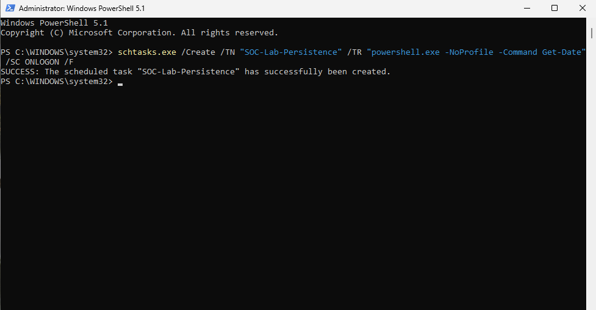
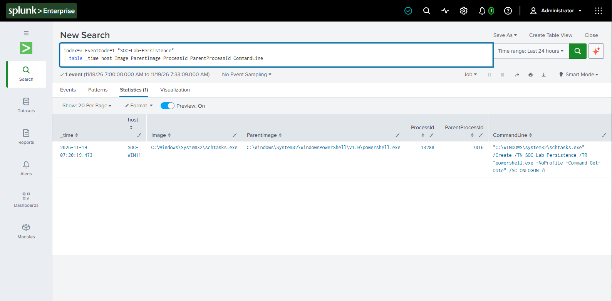
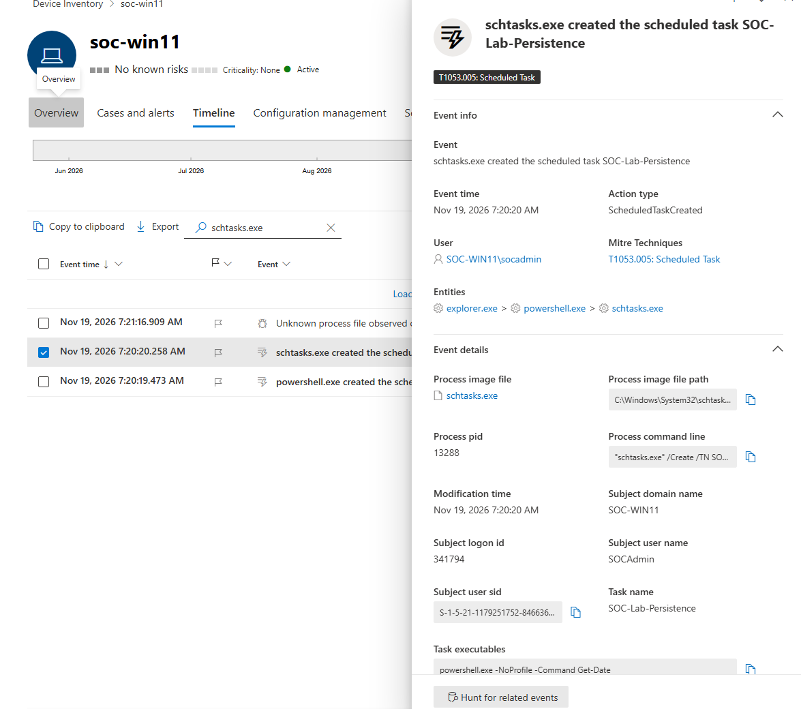
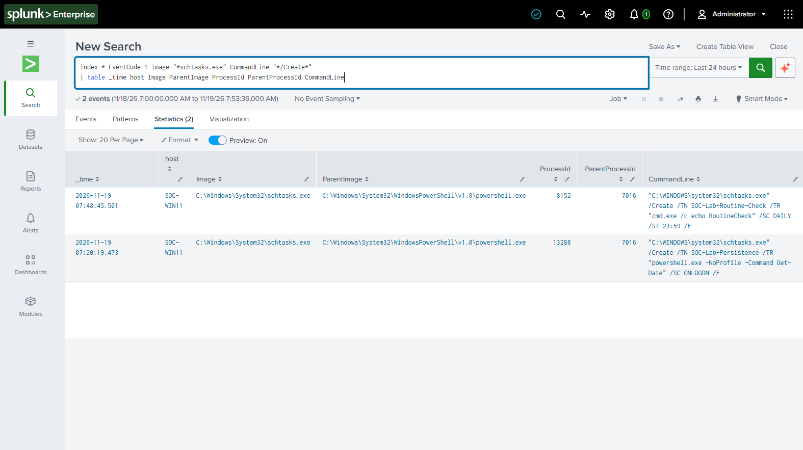
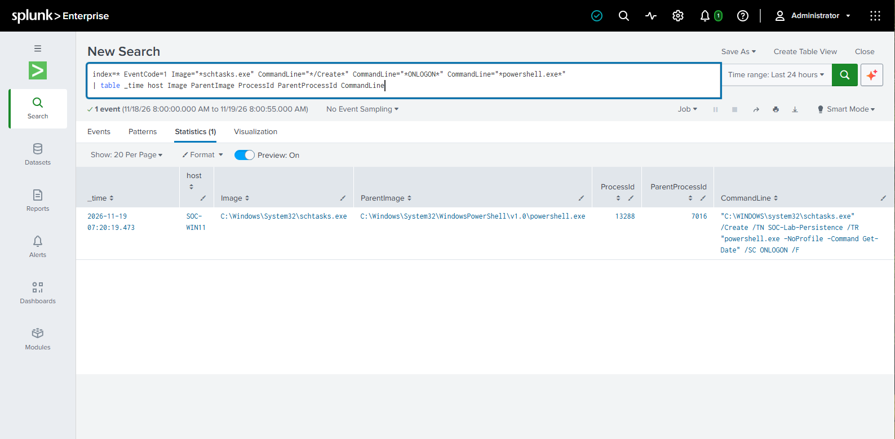
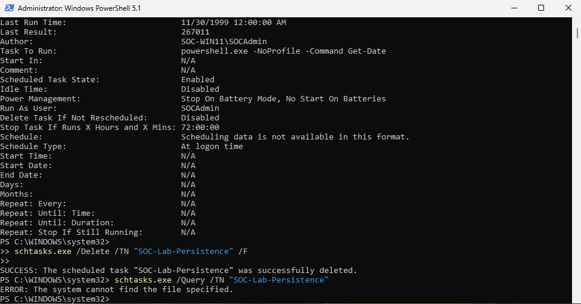
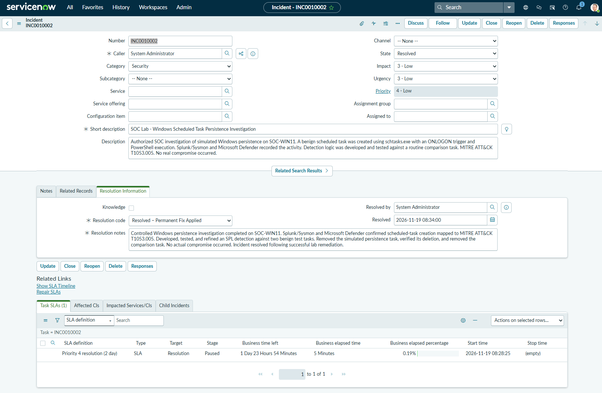

# Windows Persistence Detection & SOC Incident Response

**Controlled Cyberattack Simulation | Splunk | Sysmon | Microsoft Defender | MITRE ATT&CK | ServiceNow**

## Project Overview

This project demonstrates a controlled Windows persistence simulation and security operations investigation in an isolated cybersecurity lab.

The objective was to simulate a common persistence technique, identify the activity using security telemetry, develop and validate detection logic, and document incident response through successful remediation.

**Environment:** Windows 11 virtual machine (`SOC-WIN11`) running in VirtualBox.

**MITRE ATT&CK:** T1053.005 — Scheduled Task/Job: Scheduled Task.

**Incident:** ServiceNow INC0010002.

## Security Tools

- **Splunk Enterprise:** Security event investigation, SPL detection development, and validation.
- **Sysmon:** Windows process creation telemetry (Event ID 1).
- **Microsoft Defender for Endpoint:** Scheduled-task detection, process relationships, and endpoint investigation.
- **PowerShell:** Authorized simulation and remediation commands.
- **MITRE ATT&CK:** Classification of the simulated persistence technique.
- **ServiceNow:** Incident triage, investigation documentation, and resolution.

## Attack Simulation

A benign scheduled task named `SOC-Lab-Persistence` was created using `schtasks.exe`.

The task was configured to launch a harmless PowerShell `Get-Date` command at user logon.

This simulated the creation of a persistence mechanism without introducing actual malware.

A second task, `SOC-Lab-Routine-Check`, was created as a comparison to test detection behavior against routine scheduled-task creation.



## Splunk & Sysmon Investigation

Sysmon Event ID 1 recorded execution of `schtasks.exe` during the simulated persistence activity.

The event identified:

- Host: `SOC-WIN11`
- Process: `schtasks.exe`
- Parent process: `powershell.exe`
- Process ID: `13288`
- Parent process ID: `7016`

The process command line included the task creation arguments and `ONLOGON` trigger.



## Microsoft Defender Investigation

Microsoft Defender independently recorded the scheduled-task creation.

Defender identified the `ScheduledTaskCreated` event, confirmed process ID `13288`, displayed the process chain, and associated the activity with MITRE ATT&CK T1053.005.

This provided independent corroboration of the activity identified in Splunk.



## Detection Engineering & Validation

### Initial behavioral detection

The following SPL search identified scheduled-task creation through `schtasks.exe` without depending on a specific task name:

```spl
index=* EventCode=1 Image="*schtasks.exe" CommandLine="*/Create*"
| table _time host Image ParentImage ProcessId ParentProcessId CommandLine
```

The search returned both controlled task-creation events, demonstrating that the detection could identify multiple task names and schedules.



### Refined persistence detection

The SPL search was then refined to focus on task creation involving PowerShell execution at logon:

```spl
index=* EventCode=1 Image="*schtasks.exe" CommandLine="*/Create*" CommandLine="*ONLOGON*" CommandLine="*powershell.exe*"
| table _time host Image ParentImage ProcessId ParentProcessId CommandLine
```

**Validation results:**

- Simulated PowerShell logon task: Detected.
- Routine daily task using `cmd.exe`: Excluded.
- Matching simulated persistence events: 1.

The refined search was saved as a reusable Splunk report.

This demonstrates basic behavioral detection development and tuning using two controlled test cases. It is not a comprehensive production detection and was not configured as an automated alert.



## Incident Response & Remediation

The simulated persistence task was reviewed and confirmed to be enabled with a logon trigger.

The task was subsequently deleted. A verification query returned an error indicating that the scheduled task could no longer be found.

The routine comparison task was also deleted.

**Outcome:** Both simulated tasks were removed. No actual compromise occurred, and execution of the logon-triggered persistence task was not demonstrated.



## ServiceNow Incident Documentation

The investigation was documented in ServiceNow incident `INC0010002`.

The incident record included the simulated behavior, supporting evidence, MITRE ATT&CK mapping, detection validation, remediation actions, and final disposition.

**Resolution:** Resolved — Permanent Fix Applied, referring specifically to the removal of the simulated persistence mechanism.

**Priority:** 4 — Low.



## Key Findings

The investigation demonstrated that Windows process telemetry and endpoint security monitoring can provide complementary evidence of scheduled-task creation.

Refining detection conditions reduced irrelevant matches in the controlled test environment. Verification of task deletion demonstrated an important incident-response principle: remediation should be confirmed rather than assumed.

**Final disposition:** Authorized lab simulation; no real malicious compromise identified.

## Skills Demonstrated

Windows persistence investigation, security event correlation, Splunk SPL, Sysmon Event ID analysis, Microsoft Defender endpoint investigation, detection development and tuning, MITRE ATT&CK mapping, incident documentation, and remediation verification.
